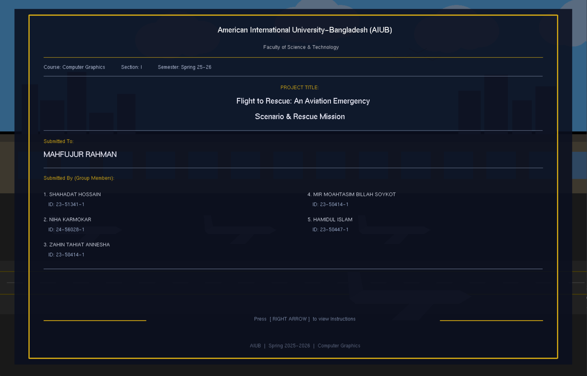
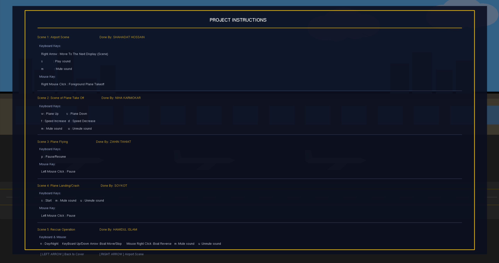
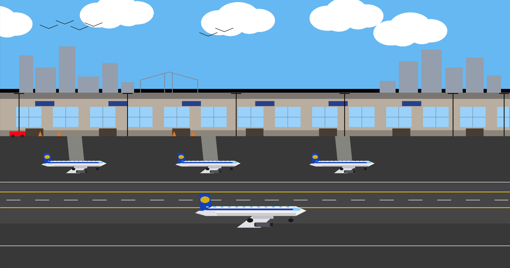
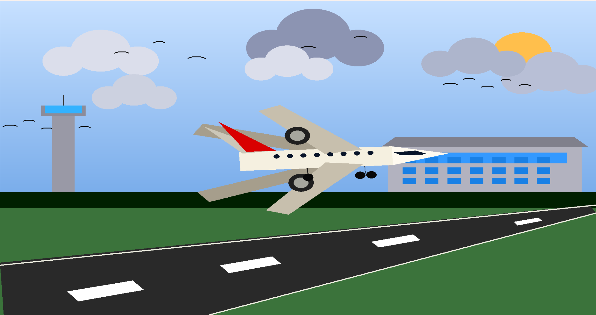
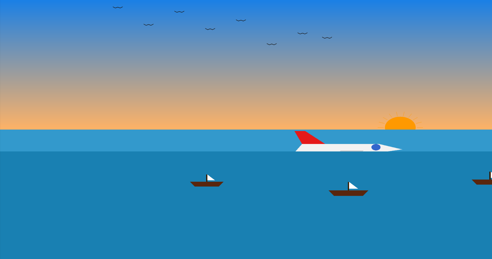
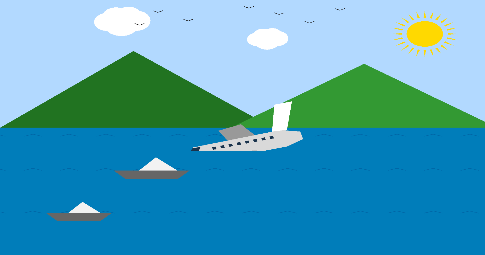
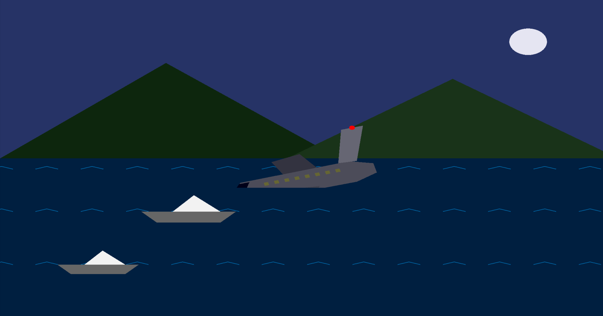

# ✈️ Flight to Rescue: An Aviation Emergency Scenario & Rescue Mission


-0078D6?style=for-the-badge&logo=windows&logoColor=white)


> **An interactive, multi-scene 2D computer graphics animation and simulation built entirely from scratch using C++, OpenGL, and the GLUT library.**

---

## 📖 Project Overview & Academic Context

**Flight to Rescue** is a story-driven 2D graphical simulation developed as the final capstone project for the **Computer Graphics** course during the **Spring 2025–2026** semester at the **American International University-Bangladesh (AIUB)**. 

The objective of this project was to demonstrate core computer graphics concepts—including 2D geometric primitive rendering, matrix transformations (`glTranslatef`, `glRotatef`, `glPushMatrix`/`glPopMatrix`), alpha blending, frame-buffer animation loops, and real-time event-driven user interaction—without relying on any external game engines or sprite sheets. Every visual object (aircraft, airport terminals, skyline, clouds, water waves, rescue boats, and birds) is mathematically constructed using OpenGL vertices, polygons, and trigonometric circle-generation algorithms.

### 🎓 Course Metadata
* **Institution:** American International University-Bangladesh (AIUB)
* **Faculty:** Faculty of Science & Technology (Department of CSE)
* **Course Title:** Computer Graphics (Section: I)
* **Semester:** Spring 2025–2026
* **Course Instructor:** Mahfujur Rahman

---

## 🛠️ Technologies & Libraries Used

* **Language:** C++ (`std::cmath`, `cstring`, `cstdio`)
* **Graphics API:** OpenGL (`GL/gl.h`) & OpenGL Utility Toolkit (`GL/glut.h`)
* **Audio & System Integration:** Windows Multimedia API (`windows.h` / `winmm.lib` via `PlaySound` for asynchronous `.wav` sound effects)
* **Rendering Pipeline:** Double-buffered 2D Orthographic Projection (`GLUT_DOUBLE | GLUT_RGB`, coordinate space `[-400, 400]` $\times$ `[-300, 300]`)

---

## 🏗️ System Architecture & Scene Pipeline

The application uses a **State-Driven Master Architecture** controlled by a global state manager (`currentPage`) running on a unified **50 FPS (`20ms`) `glutTimerFunc` loop**. Input events from the keyboard and mouse are routed dynamically based on the active scene, alongside a centralized audio controller (`updateMasterSound()`).

```text
+-------------------------------------------------------------------------+
|                        MAIN GLUT EVENT LOOP (50 FPS)                    |
|        glutDisplayFunc(display)  |  glutTimerFunc(20, update, 0)        |
+----------------------------------+--------------------------------------+
                                   |
       +---------------------------+---------------------------+
       |                           |                           |
       v                           v                           v
+--------------+           +---------------+           +---------------+
| Input Router |           | State Manager |           | Audio Manager |
| Keyboard &   |---------->| (currentPage) |---------->| Win32 Async   |
| Mouse Hooks  |           | Pages: 0 to 6 |           | WAV Playback  |
+--------------+           +-------+-------+           +---------------+
                                   |
     +------------+------------+---+--------+------------+------------+
     |            |            |            |            |            |
     v            v            v            v            v            v
 [Page 0-1]   [Page 2]     [Page 3]     [Page 4]     [Page 5]     [Page 6]
 Cover & UI   Airport      Runway       Mid-Air      Emergency    Maritime
 Overlay      Terminal     Take-Off     Cruising     Water Crash  Rescue Op
```

### Breakdown of Scenes & Graphical Features
1. **Front Cover & Instructions UI (Pages 0 & 1):** Features a live, dimmed background animation rendered using alpha blending (`GL_SRC_ALPHA`, `GL_ONE_MINUS_SRC_ALPHA`) overlaid with crisp bitmap typography (`GLUT_BITMAP_HELVETICA`).
2. **Scene 1 — Airport Terminal & Taxiing (Page 2):** Showcases a detailed urban skyline, control poles, multi-gate airport terminal, parked aircraft, service vehicles, moving clouds, flocks of birds, and a foreground commercial jet taxiing down the runway.
3. **Scene 2 — Plane Take-Off (Page 3):** Implements rotational and translational physics (`glRotatef`, `glTranslatef`) to simulate runway acceleration and pitch-up liftoff, complete with trigonometric sine-wave bird wing flapping (`sin(niha_wingFlap)`).
4. **Scene 3 — Mid-Air Cruising (Page 4):** Uses multi-layered parallax scrolling where clouds and birds move at distinct relative velocities (`0.4x` and `0.8x` background offsets) to create depth while the aircraft cruises at high altitude.
5. **Scene 4 — Aviation Emergency & Water Ditching (Page 5):** Simulates a rapid descent trajectory and water collision physics, automatically decelerating upon impact with the ocean surface (`waterLine = -50.0f`) and halting engine audio.
6. **Scene 5 — Maritime Rescue Operation (Page 6):** Features a submerged aircraft fuselage with a blinking emergency beacon, animated ocean waves, surrounding mountain topography, a dynamic **Day/Night environment toggle**, and interactive rescue boats that navigate toward the crash site.

---

## 📸 Project Screenshots & Visual Walkthrough

> 📌 *Note for Repository Setup: Place your project screenshots inside an `assets/` folder in the root directory of your repository with the filenames below.*

### 1. Front Cover & Project Instructions
| Front Cover Page | Interactive Controls & Instructions |
| :---: | :---: |
|  |  |

### 2. Storyboard Scenes (Scenes 1 – 5)
| Scene 1: Airport Terminal & Runway | Scene 2: Aircraft Take-Off |
| :---: | :---: |
|  |  |

| Scene 3: Mid-Air Cruising | Scene 4: Emergency Water Ditching |
| :---: | :---: |
|  |  |

| Scene 5: Maritime Rescue (Day Mode) | Scene 5: Maritime Rescue (Night Mode) |
| :---: | :---: |
|  |  |

---

## 🎮 Interactive Controls Guide

### 🌐 Global Scene Navigation
| Key / Input | Action |
| :--- | :--- |
| `Right Arrow` or `Enter` | Advance to the next scene |
| `Left Arrow` or `Backspace` | Return to the previous scene |

### 🕹️ Scene-Specific Controls
| Scene | Input / Key | Functionality |
| :--- | :--- | :--- |
| **Scene 1: Airport** | `Right Mouse Click` | Trigger foreground airplane taxiing & takeoff |
| | `s` / `u` / `m` | Play (`s`/`u`) or Mute (`m`) airport ambient audio |
| **Scene 2: Take-Off** | `w` / `Up Arrow` | Increase aircraft altitude (Pitch Up) |
| | `s` / `Down Arrow` | Decrease aircraft altitude (Pitch Down) |
| | `f` / `d` | Increase (`f`) or Decrease (`d`) takeoff speed multiplier |
| | `Left` / `Right Click` | Adjust plane vertical position (`+5.0f` / `-5.0f`) |
| | `m` / `u` | Mute (`m`) or Unmute (`u`) takeoff audio |
| **Scene 3: Cruising** | `p` or `Left Click` | Pause / Resume flight animation |
| | `Up` / `Down Arrow` | Increase / Decrease cruising speed |
| | `m` / `u` | Mute (`m`) or Unmute (`u`) flight audio |
| **Scene 4: Crash** | `s` / `u` | Start emergency descent animation & audio |
| | `Left Mouse Click` | Pause descent simulation |
| | `Up` / `Down Arrow` | Increase / Decrease descent, bird, and boat speeds |
| | `m` | Mute audio |
| **Scene 5: Rescue** | `n` | Toggle between **Day Mode** and **Night Mode** |
| | `Up` / `Down Arrow` | Start (`Up`) or Stop (`Down`) rescue boat movement |
| | `Right Mouse Click` | Reverse rescue boat direction |
| | `m` / `u` | Mute (`m`) or Unmute (`u`) rescue siren audio |

---

## 📂 Repository File Structure

```text
Flight-to-Rescue-OpenGL/
├── assets/                          # Project screenshots for README showcase
│   ├── cover_page.png
│   ├── instructions_page.png
│   ├── scene1_airport.png
│   ├── scene2_takeoff.png
│   ├── scene3_flying.png
│   ├── scene4_crash.png
│   ├── scene5_rescue_day.png
│   └── scene5_rescue_night.png
├── audio/                           # Sound effects (place in executable directory when running)
│   ├── planesoundeffect.wav
│   ├── airport_sound.wav
│   ├── plane1.wav
│   ├── airplane-fly-by-02.wav
│   └── Rescue.wav
├── Final Project Graphics.cpp       # Complete C++ OpenGL/GLUT source code
└── README.md                        # Project Documentation
```

---

## ⚙️ How to Compile & Run Locally

### Prerequisites
* **OS:** Windows (Required for `<windows.h>` and `PlaySound` multimedia API)
* **IDE / Compiler:** Code::Blocks (with MinGW), Visual Studio, or MSYS2 `g++`
* **Libraries:** `freeglut` (or `glut32`), `opengl32`, `glu32`, and `winmm`

### Option 1: Compiling via Terminal (MinGW `g++`)
Ensure the `.wav` audio files are in the same directory as your source file, then run:
```bash
g++ "Final Project Graphics.cpp" -o FlightToRescue.exe -lfreeglut -lopengl32 -lglu32 -lwinmm
./FlightToRescue.exe
```

### Option 2: Running in Code::Blocks
1. Create a new **GLUT/OpenGL Project** in Code::Blocks.
2. Replace `main.cpp` with `Final Project Graphics.cpp`.
3. Go to **Project $\rightarrow$ Build Options $\rightarrow$ Linker Settings** and add `winmm` to the Link Libraries list (alongside `glut32`, `opengl32`, and `glu32`).
4. Place all `.wav` sound files in the project's root directory and press **F9 (Build & Run)**.

---

## 👥 Group Members & Contributions

This project was collaboratively engineered by **Group 5**:

| # | Name | Student ID | Assigned Module & Responsibility |
| :-: | :--- | :---: | :--- |
| 1 | **Shahadat Hossain** |  ` 23-51341-1 `  | **Cover Page, Instructions UI & Scene 1:** Airport Terminal, Skyline, Ground Vehicles & Taxiing |
| 2 | **Niha Karmokar** |  ` 24-56028-1 `  | **Scene 2:** Runway Perspective, Control Tower & Aircraft Take-Off Physics |
| 3 | **Zahin Tahiat Annesha** |  ` 23-50414-1 `  | **Scene 3:** High-Altitude Cruising & Multi-Layer Parallax Cloud/Bird Animation |
| 4 | **Mir Moahtasim Billah Soykot** |  ` 23-50442-1 `  | **Scene 4 & System Integration:** Emergency Water Ditching Simulation & Master Code Merging |
| 5 | **Hamidul Islam** |  ` 23-50447-1 `  | **Scene 5:** Maritime Rescue Operation, Day/Night Cycle & Wave/Boat Mechanics |

---

<p align="center">
  <i>Computer Graphics Course at American International University-Bangladesh (AIUB)</i>
</p>
